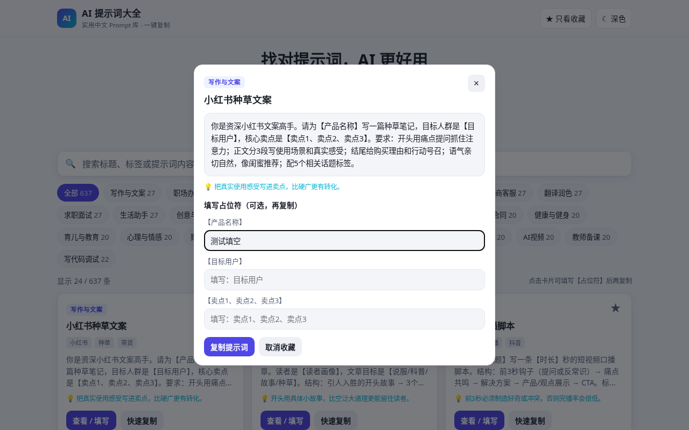

# AI 提示词大全 · Chinese Prompt Library

> 面向中国用户真实场景的开源中文 AI 提示词库：写作、职场、短视频/闲鱼运营、求职、编程、副业、教学、AI 绘画/视频……一键复制，支持收藏与深色模式。

**在线使用：** [https://812822586-droid.github.io/ai-prompts/](https://812822586-droid.github.io/ai-prompts/)

如果这个项目对你有帮助，请点右上角 **Star ⭐**，让更多人发现它！

---

## 截图

### 桌面端


### 手机端


### 填写占位符



---

## 功能

- 🔍 **搜索**：按标题、标签、正文即时筛选
- 🏷️ **分类标签**：27 个分类，覆盖写作到 AI 视频、教师备课等
- 📋 **一键复制** + 「已复制」提示
- ★ **收藏**：保存在浏览器 localStorage，可「只看收藏」
- ✏️ **填写【占位符】**：打开卡片后可先填再复制
- 📄 **加载更多**：默认每页 24 条，避免一次渲染过多卡片
- ☾ **深色 / 浅色** 模式
- 📱 **手机适配**，纯静态，无构建、无强制 CDN

## 怎么用

1. 打开 [在线版](https://812822586-droid.github.io/ai-prompts/)，或下载本仓库后双击打开 `index.html`
2. 用搜索或分类找到提示词
3. 点「快速复制」，或点「查看 / 填写」填好【占位符】再复制
4. 粘贴到 ChatGPT、Claude、通义、文心、Kimi、豆包等任意大模型对话框

## 分类与数量

本仓库当前内置 **690** 条原创提示词（以 `prompts-data.js` / `prompts.json` 为准）。

| 数量 | 分类 |
|---:|:---|
| 32 | 职场办公 |
| 31 | 学习与考试 |
| 31 | 小红书抖音闲鱼 |
| 31 | 生活助手 |
| 30 | 电商客服 |
| 29 | 创意与绘画 |
| 29 | 求职面试 |
| 29 | 编程辅助 |
| 28 | PPT与汇报 |
| 28 | 写作与文案 |
| 28 | 数据分析 |
| 28 | 角色扮演 |
| 27 | 翻译润色 |
| 25 | 自媒体运营 |
| 24 | Midjourney即梦绘画 |
| 24 | 副业赚钱 |
| 23 | 写代码调试 |
| 22 | AI视频 |
| 22 | 教师备课 |
| 22 | 旅行规划 |
| 22 | 营销策划 |
| 21 | 产品与创业 |
| 21 | 健康与健身 |
| 21 | 心理与情感 |
| 21 | 育儿与教育 |
| 21 | 财务与理财 |
| 20 | 法律与合同 |

## 更新日志（CHANGELOG）

- **2026-11-16**：新增 28 条提示词（总数 690 条）。结合本周动态：AI 单次输入有上限时的超长文档分段接力、同一任务多模型对比评测、让 AI 回答附可核查来源、大模型 API 接入设计与限流报错排查、AI 智能体上线前风险清单；生活与内容场景：聚餐找店、自制糖葫芦、新手增肌、旅行穿搭出片、秋冬采摘、“纯过日子”笔记、闲鱼手作上架、辟谣科普、综艺二创合规；年末季：双12客服话术、元旦活动、期末复习与评语、寒假约定、年底收支盘点、年末感谢信、年底跳槽评估等。
- **2026-11-09**：新增 25 条提示词（总数 662 条）。紧跟本周热点：即梦 Seedream 5.5 多轮编辑、透明背景素材、海报文字渲染；Kimi 超长上下文资料提炼、AI 智能体任务说明书；15 秒带声音 AI 短视频；双 11 售后、闲鱼转卖、快递清单与大促复盘；年终总结/述职、考研冲刺、国考申论等。
- **2026-11-08**：扩充至 637 条，新增分类并支持加载更多。

## 本地预览

无需安装依赖：

```bash
# 方式一：直接用浏览器打开
open index.html

# 方式二：任意静态服务器（可选）
python3 -m http.server 8080
```

## 贡献一条提示词

见 [CONTRIBUTING.md](CONTRIBUTING.md)。简单说：在 `prompts-data.js` 里加一条带 `title / category / tags / prompt / tip` 的对象，再提 PR。

## 灵感参考

界面与「角色扮演 / Act as」类灵感参考了 [prompts.chat](https://prompts.chat)（[awesome-chatgpt-prompts](https://github.com/f/awesome-chatgpt-prompts)，CC0）。本站提示词为面向中国场景的**原创中文内容**，并非逐条翻译或复制。

## License

[MIT](LICENSE) © 2026 812822586-droid

---

## English

**AI Prompt Library (Chinese-first)** — a static site with **690+** original prompts across **27** categories (writing, work, ops, coding, side hustles, teaching, AI image/video, and more). Search, filter, one-click copy, favorites (localStorage), placeholder fill-in, load-more pagination, dark mode. No build step.

- Live: https://812822586-droid.github.io/ai-prompts/
- Open `index.html` locally, or enable GitHub Pages on the `main` branch `/` root
- Inspired by [prompts.chat](https://prompts.chat) (awesome-chatgpt-prompts, CC0); content here is original Chinese scenarios
- Contributions welcome — see `CONTRIBUTING.md`
- Star ⭐ if you find it useful!
